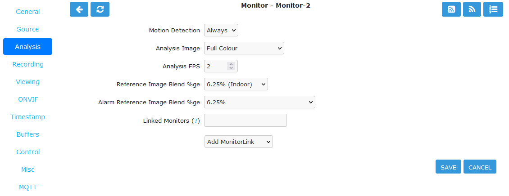

Analysis Tab
------------

    The Analysis tab contains settings relating to motion detection.

    Monitor Analysis Tab

- **Motion Detection**

    - None: Do not perform motion detection. Recording can still be triggered manually.
    - Always: Perform motion detection.

- **Analysis Image**

    - Full Colour: Perform the detection using the full RGB image
    - Y-Channel: If the capture process results in an image in YUV format, the Y channel is a grey scale image. Performing motion detection on just Y channel uses 1/4 of processing compared to the full colour image.

- **Analysis FPS**: Motion detection is not required on every frame captured. For a stream captured at 30 FPS, motion detection can be adequate at 5 FPS for most cases. Motion detection is very CPU intensive so reducing the Analysis FPS as low as possible allows more cameras to be added to the system.
- **Reference Image Blend %ge**: Each analysed image in ZoneMinder is a composite of previous images and is formed by applying the current image as a certain percentage of the previous reference image. Thus, if we entered the value of 10% here, each image’s part in the reference image will diminish by a factor of 0.9 each time round. So a typical reference image will be 10% of the previous image, 9% the one before that and then 8.1%, 7.2%, 6.5% and so on of the rest of the way. An image will effectively vanish around 25 images later than when it was added. This blend value is what is specified here and if higher will make slower progressing events less detectable as the reference image would change more quickly. Similarly, events will be deemed to be over much sooner as the reference image adapts to the new images more quickly. In signal processing terms the higher this value the steeper the event attack and decay of the signal. Default value is 6.25% for Indoor cameras and 12.5% for Outdoor cameras.
- **Alarm Reference Image Blend %ge**: This is defined similar to Reference Image Blend but only applies during alarm states. This allows the alarm blend to be different than the reference blend.
- **Linked Monitors**: This field allows you to select other monitors or zones on your system that act as triggers for this monitor. So if you have a camera covering one aspect of your property you can force all cameras to record when that camera detects motion or other events. You can either directly enter a comma separated list of monitor IDs or click on :guilabel:`Add Monitor Link` pulldown menu. Be careful not to create circular dependencies with this feature as it may cause infinitely persisting alarms. To unlink monitors you can ctrl-click. You can also enter logical operators here to create more complex logic ( | = OR, & = AND).  So A | B means record if either A or B is alarmed. A & B means trigger if both A and B are alarmed.

Object Detection
^^^^^^^^^^^^^^^^

Object detection looks for objects such as people and vehicles in the frames
that motion detection analyses (the Analysis FPS applies to both), and runs
only while Motion Detection is not None.

- **Object Detection**: the backend that runs the detection, or None. Only the
  backends built into this installation are offered.
- **Detection Model**: what the backend needs to find its model. For the http
  backend this is the URL of the inference server.
- **Object Threshold**: the minimum confidence, from 0 to 1, for a class that
  has no detection settings of its own.
- **NMS Threshold**: the overlap, from 0 to 1, above which boxes of the same
  class are merged, for backends that run a model themselves.

Each class has detection settings (the AI_Detection_Settings table), global or
per monitor: whether it is detected at all, its confidence threshold, the colour
of its box, and whether it reports. Detected objects are outlined on the
analysis image and stored with the event, which is tagged with their classes.
Only classes that report raise an alarm: their highest confidence, as a
percentage, is added to the frame's score and the cause reads, for example,
``Object:person, dog``.

When inference falls more than two seconds behind the camera, frames are
skipped until it catches up, and the last boxes are drawn on the frames in
between inferences.

http backend
""""""""""""

The http backend posts each analysed frame to an inference server, which can run
on another machine and with any framework. The request is
``multipart/form-data`` with the frame as a JPEG in ``file`` and the monitor's
id in ``monitor_id``. The server answers with JSON::

    {"detections": [
      {"label": "person", "confidence": 0.91, "bbox": [120, 80, 64, 180], "class_id": 0}
    ]}

``bbox`` is ``[x, y, width, height]`` in pixels of the JPEG that was sent, and
``class_id`` is optional. A request that fails, times out after five seconds or
gets an answer that isn't JSON is logged, and the backend is set up again 30
seconds later. Frames are sent to whatever URL is configured, so only point it at
a server you trust.
